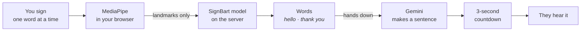
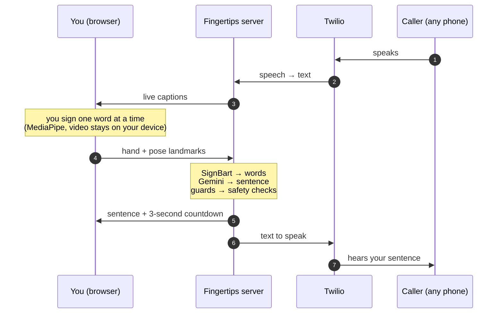
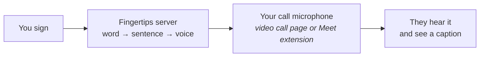

# Fingertips

**Your hands. Your voice.**

Fingertips lets Deaf, hard-of-hearing and nonspeaking people make real phone calls and video calls in their own
language. The other person's words appear as live captions. You answer in ASL, by tapping or by typing, and
Fingertips speaks your reply. The person on the other end uses an ordinary phone or browser and installs nothing.

| | |
|---|---|
| Live app | https://66-135-26-183.sslip.io (Chrome on a laptop) |
| Phone number | +1 (878) 877-6285 |
| Google Meet extension | [talkbridge-meet.zip](https://66-135-26-183.sslip.io/talkbridge-meet.zip) |
| ASL sign cards | [print/asl-top200-cards.pdf](print/asl-top200-cards.pdf) |
| JAM | https://66-135-26-183.sslip.io/jam |

Built by Ganesh Munagala at HackUMass XIV (November 13–15, 2026). Sign recognition uses the model and
preprocessing from [Fingertip by Shruti](https://github.com/Shrutibrahma/HackUMass-26) (used with permission),
SignBart-ASL-2730 trained on ASL Citizen, and Google MediaPipe. JAM's finger-count → chord idea is from
[Gesture Synth](https://github.com/ericwei97-cloud/gesture-synth) by Eric Wei.

---

## Contents

1. [Features](#1-features)
2. [Getting started](#2-getting-started)
3. [Architecture](#3-architecture)
4. [Project structure](#4-project-structure)
5. [Local setup](#5-local-setup)
6. [Deployment](#6-deployment)
7. [Testing](#7-testing)
8. [Sign recognition accuracy](#8-sign-recognition-accuracy)
9. [Limitations](#9-limitations)

---

## 1. Features

### Phone calls

- A familiar phone app in the browser: Keypad, Contacts and Recents.
- Call any US number, or receive calls on the Fingertips number. Incoming calls ring in the browser with
  Accept and Decline.
- Everything the caller says appears as live captions, first as a draft and then final. Caption size is adjustable.
- Answer by signing, with one-tap quick replies, with AI reply suggestions, or by typing a few words
  ("yes 8 works") that become a full sentence.
- The caller first hears *"Hi, this is Ganesh's interpreter. How are you?"* (set with `USER_NAME` or `GREETING`).

### Signing in ASL



| Step | What happens |
|---|---|
| Sign | A sign starts when your hand comes up and moves, and ends when your hands drop or hold still. Each recognized word is added to your reply. |
| Check | If the model isn't sure, it shows its top guesses so you can pick the right one. |
| Send | Keep your hands down for about 1.5 seconds. Gemini turns the words into a sentence and counts down 3 seconds before speaking it. Cancel, sign again or type to stop it. Auto-send can be turned off in Settings. |

Sign sets (Settings → Sign recognition):

| Set | Size | Notes |
|---|---|---|
| Top 200 (default) | 200 signs | Everyday and phone-call signs. Most accurate. |
| All signs | 2,730 signs | Full ASL Citizen vocabulary. More words, more mistakes. |
| Everyday | 59 signs | Measured by Fingertip on real signers. |
| Quick signs | 7 hand shapes | Thumb up = "Yes.", flat palm = "One moment", fist = say the top suggestion. Instant, no model. |

Video never leaves your device: only hand and body landmark coordinates are sent, one sign at a time.
The model takes about 12 ms per sign on the server's CPU.

### Video calls

A one-to-one video call where the guest needs no app or account.

1. On the Keypad, tap the video button. A call page opens with an invite link.
2. Send the link. The other person opens it in Chrome and taps Join call.
3. Sign or type on the right. They hear your sentence in a voice and see it as a caption over your video.
4. What they say is captioned for you, using speech recognition in their browser.

### Google Meet extension

Sign in a Google Meet call. Your sentence is spoken into your Meet microphone and drawn as a caption on your
camera, so everyone in the meeting hears and sees it. Nobody else installs anything.

1. Download [talkbridge-meet.zip](https://66-135-26-183.sslip.io/talkbridge-meet.zip) and unzip it.
2. In Chrome, open `chrome://extensions`, turn on Developer mode, click Load unpacked and choose the `talkbridge-meet` folder.
3. Join Google Meet after installing (or turn your mic and camera off and on once).
4. Click Fingertips at the bottom left, then Open signing window. Sign, then drop your hands.

| Option | Default | What it does |
|---|---|---|
| Voice only | On | Keeps your real microphone silent, so you can leave Meet's mic on and people hear only your signed sentences. |
| Show what I sign | On | A box at the top of your screen shows each sign and its meaning, the words so far, the countdown and what was spoken. Only you see it. |
| Caption on my camera | On | Draws your sentence into your outgoing video. |

If Meet's mic is muted when a sentence is ready, Fingertips unmutes it, speaks, and mutes it again.

### Safety guards

An AI that changes what you meant is worse than no AI on a live call. Every reply passes through
`server/guards.py`:

| Guard | What it prevents |
|---|---|
| Fact check | Suggestions that invent numbers, times, dates or days nobody said. |
| Polarity lock | A "no" becoming a "yes", or the other way round. |
| Confirm sheet | Agreeing to money, payments, orders or bookings without an extra tap. |
| Retry-safe send | A double tap or network retry being spoken twice. |
| Barge-in | A reply cut off by the caller is marked, with a "Say it again" button. |
| Signature check | Fake requests pretending to be Twilio. |

### Sign cards

A printable PDF of the 200 supported signs ([print/asl-top200-cards.pdf](print/asl-top200-cards.pdf)). Each card
has numbered steps in plain English, pictures traced from a real Deaf signer, and a QR code to a video of the sign.

### JAM

A gesture-controlled instrument at `/jam` where every note is also drawn on screen, so a Deaf player can make and
follow music without hearing it.

| Part | What it does |
|---|---|
| Hands → music | Left-hand fingers 1–5 pick chords (C, Dm, Em, F, G). Right hand height sets volume, tilt sets tone, pinch holds. Melody and drum modes. |
| Music → visuals | Pitch = height, loudness = width and glow, chords = connected labelled nodes, rhythm = beat lines and a 16-step grid. |
| Play together | Invite link to a shared room with a shared clock and tempo. |
| Export | Record, replay, and export JSON, PNG artwork and WAV. |

---

## 2. Getting started

1. Open https://66-135-26-183.sslip.io in Chrome on a laptop and allow the camera and microphone.
2. Receive a call by calling **+1 (878) 877-6285** from any phone, then click Accept. Or type a number on the
   Keypad and press Call.
3. Read the caller's words as captions.
4. Reply by signing a few words from the [sign cards](print/asl-top200-cards.pdf) (try HELLO, YES, THANK-YOU,
   HELP, LATER), then drop your hands. You can also tap a suggestion or type.

---

## 3. Architecture

### Phone call



### Video call and Google Meet

There is no Twilio here. The server turns the sentence into a voice, and the browser mixes it into the
microphone the call is sending.



### Components

| Component | Technology | Role |
|---|---|---|
| Web app | HTML, CSS, JavaScript (no build step) | Phone UI, captions, replies, signing panel |
| Hand tracking | Google MediaPipe Tasks Vision | Hand and pose landmarks, in the browser |
| Sign model | SignBart-ASL-2730 (ONNX Runtime) | Landmarks → ASL word, about 12 ms on CPU |
| Sentences | Google Gemini | Words → natural sentence and reply suggestions (rules fallback without a key) |
| Voice for video and Meet | Gemini speech generation | Sentence → spoken audio |
| Phone calls | Twilio Voice + ConversationRelay | Speech → text for captions, text → speech for replies |
| Server | Python, FastAPI | API, WebSockets, guards, video call signaling |
| Video calls | WebRTC | Peer-to-peer video and audio between two browsers |
| Meet extension | Chrome Manifest V3 | Mixes the voice into the mic and draws captions on the camera |
| Hosting | Docker Compose, Caddy, Vultr | HTTPS with automatic certificates |

---

## 4. Project structure

```
fingertips/
├── server/                     FastAPI backend
│   ├── main.py                 calls, incoming calls, Twilio relay, web routes
│   ├── asl.py                  sign recognition API (SignBart, top-200 filter)
│   ├── ai.py                   Gemini sentences and reply suggestions
│   ├── guards.py               safety checks on every reply
│   ├── meet.py                 video call rooms, sentence and voice APIs
│   ├── jam.py                  JAM multiplayer rooms
│   ├── setup_inbound.py        points the Twilio number at this server
│   ├── popup.py                Mac only: brings the tab forward on an incoming call
│   └── data/asl_top200.json    the 200 signs and their measured accuracy
├── web/                        browser app
│   ├── index.html, app.js      phone UI, call screen, settings
│   ├── asl.js                  camera → MediaPipe → one sign at a time
│   ├── signpad.js              signing panel for video calls and Meet
│   ├── signs.js                7 quick hand signs
│   ├── video/                  video call page
│   ├── sign/                   signing window opened by the Meet extension
│   └── jam/                    JAM instrument
├── extension/                  Google Meet extension
├── eval_signs/                 choosing and measuring the 200 signs, building the sign cards
├── print/                      sign cards PDF
├── tests/                      Python and browser tests
├── deploy/                     Docker Compose and Caddy configuration
├── Dockerfile
└── fingertip/                  Fingertip by Shruti (sign model and preprocessing)
```

---

## 5. Local setup

**Requirements:** Python 3.12+, a Twilio account with a phone number, a public HTTPS address (a free
`cloudflared` tunnel works), and a Gemini API key (optional for calls, needed for the video and Meet voice).

```bash
git clone https://github.com/GaneshMunagala714/fingertips && cd fingertips
python3 -m venv .venv && . .venv/bin/activate
pip install -r server/requirements.txt
cp .env.example .env                               # fill in the values below
cloudflared tunnel --url http://localhost:8000     # copy the https URL into PUBLIC_URL
uvicorn server.main:app --port 8000
python -m server.setup_inbound                     # route calls to your number to this server
```

Then open http://localhost:8000.

| Variable | Description |
|---|---|
| `TWILIO_ACCOUNT_SID`, `TWILIO_AUTH_TOKEN`, `TWILIO_NUMBER` | Twilio credentials and phone number |
| `PUBLIC_URL` | Public HTTPS address of this server |
| `GEMINI_API_KEY`, `GEMINI_MODEL` | Sentences, suggestions and the video/Meet voice |
| `USER_NAME`, `GREETING` | What the caller hears first |
| `VALIDATE_TWILIO_SIGNATURE` | Keep `true` |

In the Twilio console, accept the Voice "Predictive and Generative AI/ML Features Addendum", which
ConversationRelay requires. Trial accounts can only call verified numbers.

---

## 6. Deployment

Fingertips runs on a small shared-CPU server (2 vCPU, 4 GB, Ubuntu 24.04). No GPU is needed: hand tracking runs
in the browser and the sign model runs on the CPU.

```bash
# on the server, with the repository and .env in /srv/talkbridge
curl -fsSL https://get.docker.com | sh
ufw allow 80/tcp && ufw allow 443/tcp
cd /srv/talkbridge/deploy
echo DOMAIN=<your-ip-with-dashes>.sslip.io > .env
docker compose up -d --build

# then, on your machine
PUBLIC_URL=https://<your-ip-with-dashes>.sslip.io python -m server.setup_inbound
```

Caddy obtains the HTTPS certificate automatically, and `sslip.io` provides a hostname for any IP address, so no
domain is needed.

---

## 7. Testing

```bash
python -m pytest -q tests                        # guards, call flow with a fake Twilio, incoming calls, JAM rooms
node --test tests/jam/logic.test.mjs             # JAM music theory and gesture mapping
node tests/jam/smoke.mjs http://localhost:8000   # JAM in real Chrome (Playwright, fake camera)
```

The video call was tested end to end with two Chrome browsers (video both ways, signed sentence heard by the
guest). The Meet extension was tested in a live Google Meet call and on a stand-in meeting page (voice in the
outgoing microphone, caption in the outgoing video).

---

## 8. Sign recognition accuracy

| Step | Detail |
|---|---|
| Candidates | ASL-LEX 2.0 frequency ratings, six published core-vocabulary lists and phone-call vocabulary |
| Measurement | Each candidate run through the Fingertips pipeline on 8 real signers' clips from ASL Citizen; signs the model confuses were dropped |
| Result | 88.9% (1,422 of 1,600 clips) recognized within the 200-sign set; 68.1% when all 2,730 signs are allowed |
| Pipeline fix | Sending only frames with visible hands cut accuracy from 89.5% to 77.1%; the browser now sends the whole sign plus half a second before it |

The test clips may overlap the model's training data, so accuracy with new signers will be lower. The scripts
are in `eval_signs/`. The sign cards are built by `eval_signs/make_cards.py` from `eval_signs/howto.json`.

---

## 9. Limitations

- Recognizes isolated ASL signs, one at a time. Continuous ASL sentences, fingerspelling and other sign languages
  are not supported.
- Some numbers have no sign in the model (two, four, five, ten): type them instead.
- Tested with real hands and real calls, but not yet with Deaf users.
- Video calls are one-to-one, and guest voice captions need Chrome.
- The Meet extension works in Chrome with Google Meet only.
- Incoming calls ring only while the app is open in a browser tab.
