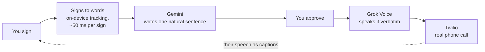
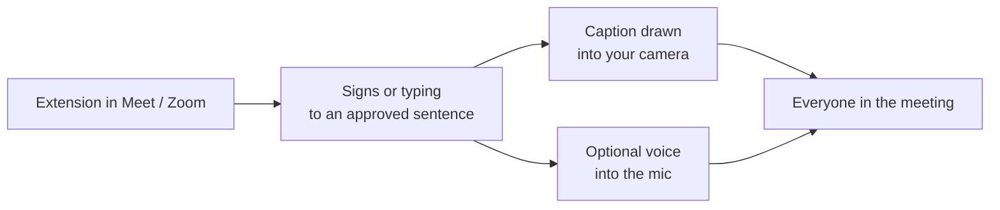
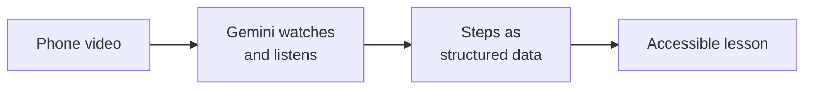

# FingerTips

**Ordering dinner. Booking a doctor. Joining a meeting. Learning a new job.**
**They all assume you can hear.**

FingerTips is one ecosystem that makes those everyday moments work for Deaf, hard-of-hearing
and non-speaking people. You sign, and the person on the other end of a real phone call hears a
natural voice. You join a meeting, and your hands get captions, not just everyone else's voice.
You watch a training video, and every step is shown, looped and written out, with nothing left
to sound.

Built in 36 hours at HackUMass XIV.

## Live now

| | |
|---|---|
| Demo video | https://youtu.be/y6x7Rp9-KN8 |
| Live calling app | https://66-135-26-183.sslip.io (Chrome on a laptop) |
| Phone number | +1 (878) 877-6285 |
| Google Meet extension | [talkbridge-meet.zip](https://66-135-26-183.sslip.io/talkbridge-meet.zip) |
| ASL sign cards | [print/asl-top200-cards.pdf](print/asl-top200-cards.pdf) |
| JAM | https://66-135-26-183.sslip.io/jam |

## Where everything lives

| Folder | What it is |
|---|---|
| repo root (`server/`, `web/`, `extension/`, `deploy/`) | The deployed calling app: phone and video calls, Meet voice, JAM. Full guide: [LIVE_APP.md](LIVE_APP.md) |
| [`fingertip/`](fingertip/README.md) | The FingerTips phone app (Call, Meet captions, Play), the call server with Gemini and Grok Voice, and the sign model |
| [`fingertip/learn/`](fingertip/learn/README.md) | Learn: turns any hands-on video into an accessible lesson |
| [`fingertip/docs/`](fingertip/docs/) | Architecture diagrams (draw.io), Devpost write-up, team notes |

---

## The problem

| | |
|---|---|
| **1.5 billion** | people live with hearing loss. **430 million** need rehabilitation, and that grows to **700 million+ by 2050**. (WHO, March 2026) |
| **1 in 20** | Deaf or hard-of-hearing people can complete tasks over the phone. **70%** ask family to make calls for them. (BT and UK Council on Deafness) |
| **57.7%** | of Deaf adults are employed, more than 15 points below hearing adults. (National Deaf Center) |
| | NSF-funded research on machining training found Deaf learners hit obstacles in the foundational stages, where most of the teaching is spoken. |

Phones, meetings and training were all designed around sound. Most tools fix one of them. We
wanted to fix the whole day.

## Not one app. An ecosystem.

| | Tool | Life stage | What it does |
|---|---|---|---|
| **Connect** | **Call** | Everyday | Sign during a real phone call. They hear a human-sounding voice. You read their words as captions. |
| **Participate** | **Meet** | School and work | A Chrome extension for Google Meet and Zoom that captions your hands, drawn right into your camera. |
| **Grow** | **Learn** | Learning | Any hands-on video becomes a step-by-step lesson you can follow with your eyes. Lives in [`learn/`](fingertip/learn/README.md). |
| **Express** | **Play** | Expression | Your gestures play music you can see. Pitch and rhythm become shapes and colour. |

The editable architecture diagrams are in [`fingertip/docs/architecture.drawio`](fingertip/docs/architecture.drawio). Open the
file in [diagrams.net](https://app.diagrams.net) or the VS Code Draw.io extension. It has
four pages: Overview, Call, Meet and Learn.

---

## Call

### What already exists

| | Sign in a real call | They install nothing | No interpreter in the middle | AI helps you phrase it, you approve it |
|---|:-:|:-:|:-:|:-:|
| Video Relay Service | Yes | Yes | No | No |
| Rylo, Rogervoice | No | Yes | Yes | No |
| Apple Live Speech | No | Yes | Yes | No |
| Google SL2T | Yes | No | Yes | No |
| **FingerTips** | **Yes** | **Yes** | **Yes** | **Yes** |

### What's new

- **You sign during a real call.** Other apps make you type, or put a human interpreter
  between you and the person you're talking to.
- **The voice sounds human.** Not a robotic text-to-speech line: a natural voice with real
  pauses that can be interrupted, like a person on the phone.
- **Every answer is yours.** The AI suggests a sentence and you approve it. It never agrees to a
  payment, a booking or a time that you didn't sign.

### How it works



1. **Signs to words.** MediaPipe tracks your hands and body in the browser. Only x/y points
   leave the phone, never video. The server names each sign with SignBart (exported to ONNX,
   about 30 ms per sign). There are 50 everyday signs (hello, yes, no, help, tomorrow, bathroom,
   and more). If the model isn't sure, it shows you two options and waits.
2. **Gemini** turns your signs, plus what the caller just asked, into one natural sentence.
3. **You approve.** Guards check that every number, time, price and name in that sentence came
   from you, your note or the caller. A signed NO always becomes a no. Money and bookings
   need an extra tap.
4. **Grok Voice** speaks the approved words exactly as written, in native phone audio.
5. **Twilio** carries the real call. The other person just answers their phone.

All of this is orchestrated by one FastAPI service on **Vultr**.

### Why Grok

- **Native phone audio.** It speaks μ-law at 8 kHz, the format phone lines use, so there's no
  transcoding step adding delay.
- **Natural interruptions.** If the caller talks over the voice, it stops like a person would.
- **Approved words, verbatim.** Sentences with facts in them are sent with xAI's
  `force_message`, so the model can't reword them.

The real settings are `VOICE_ENGINE=grok`, `XAI_API_KEY` and `GROK_VOICE_MODEL`. Without them the
call runs on Twilio ConversationRelay with an ElevenLabs voice.

---

## Meet

**Meetings caption voices. Not hands.**

Google Meet and Zoom already show captions for people who speak. The extension adds the other
half: you sign or type, approve the sentence, and it's drawn into your own camera tile so
everyone in the meeting can read it. Optionally, a voice says it into the meeting too, using
Gemini text-to-speech or ElevenLabs. Nobody else installs anything.



---

## Learn

**The gap.** Hands-on jobs are taught by someone standing next to you and talking: "now grab
the screw, not that one, the short one." Training videos help, but the important moment lasts
half a second, and the explanation is spoken, not shown.

**Built from scratch.** Film the job once on a phone. Gemini watches and listens, and turns it
into a lesson in under 40 seconds.



A real step from the demo lesson (trimmed):

```json
{ "title": "Connect ground wire to rail", "start": 137.0, "end": 141.6, "hand": "R",
  "materials": ["black jumper wire", "breadboard", "Arduino Uno"],
  "key_points": ["Ensure wire is seated firmly in the negative rail pinhole"],
  "transcript": [
    { "t": 137.0, "text": "Right hand positions the pin of the black wire over the top blue rail near column 60" },
    { "t": 138.5, "text": "Right hand presses the black wire pin into the top blue rail hole at column 60" },
    { "t": 140.5, "text": "Right hand releases the black wire" } ] }
```

Each step plays on a loop at the speed you choose, with captions saying what the hands do. A
numbered map shows where each step happens, and you can type a question about the task. Saved
lessons open instantly and never call the model again. Details: [learn/README.md](fingertip/learn/README.md).

### Why Gemini

- **Video plus audio** in one model, so the lesson knows both what was done and what was said.
- **Grounded in time.** Every step has MM:SS start and end times.
- **Grounded in space.** Every location is a box in 0 to 1000 coordinates, which becomes the
  workspace map.
- **Structured data.** The output is validated JSON, not prose we have to parse.
- **Agentic video** (Google-reported): 88% fewer tokens, 66% lower cost, 7% better accuracy.

The same engine also powers **Show it** inside a call: film a problem (a leak, a warning light)
and the other person gets the facts, each linked to the exact frame.

---

## Play

Sound becomes something you can see and steer. Move your hand left and right to choose a note,
raise it to make the sound brighter, and pinch to play. An open palm plays a soft chord. Every
note sits on a pentatonic scale, so nothing sounds wrong, and the music draws itself on screen as
you play. It runs entirely in the browser, with haptics where the device supports them.

---

## Try it in two minutes

You need Python 3.11+ and Node 20+. No API keys are needed to try it: without keys, the server
uses a rules-based brain and a simulated phone line, so every screen works.

```bash
cd fingertip/app
npm ci
npm run build
```

```bash
cd fingertip/server
python -m venv .venv
.venv\Scripts\activate
pip install -r requirements.txt
uvicorn app.main:app --port 8000
```

Learn runs as its own small server. In a second terminal:

```bash
cd fingertip/learn
python -m venv .venv
.venv\Scripts\activate
pip install -r requirements.txt
python run.py
```

On Mac or Linux, activate with `source .venv/bin/activate` instead.

Then open:

| Link | What you see |
|---|---|
| http://127.0.0.1:8000/#demo | **Start here.** Skips setup and rings a rehearsal call from "Mom" right away |
| http://127.0.0.1:8001/ | **Learn.** Opens straight into the demo lesson, already playing |
| http://127.0.0.1:8000/ | The phone app |
| http://127.0.0.1:8000/#signs-lab | Sign recognition lab: camera, framing, hand setting |
| http://127.0.0.1:8000/#gallery | Every screen at once |

Use `127.0.0.1`, not `localhost`. On Windows, `localhost` tries IPv6 first and adds about
200 ms to every request.

**Meet extension:** in Chrome, open `chrome://extensions`, turn on Developer mode, click
**Load unpacked** and choose `fingertip/extension/`.

**Real calls:** copy `.env.example` to `.env` and fill in Twilio, Gemini and (optionally) xAI
keys. Deployment to Vultr is one command (`docker compose up -d --build`). It starts the call
server, Learn (at `learn.` plus your domain) and Caddy, which handles HTTPS.
Full steps are in [docs/team/HANDOFF.md](fingertip/docs/team/HANDOFF.md).

### Tests

```bash
cd fingertip/server && python -m pytest -q tests
```

```bash
cd fingertip/app && npx vitest run
```

```bash
python fingertip/eval/bench.py
```

Today that's 74 server tests and 13 app tests passing, plus 40 conversation cases in the bench.

---

## What we measured

| Check | Result |
|---|---|
| 313 real ASL Citizen clips, our signs, hand setting matched | 96% top-1 within our vocabulary |
| Real signer phrases through the app's own pipeline | 22 of 24 signs right |
| Frame rate tolerance | 98% at 15 fps, 95% at 10 fps, 93% at 6 fps |
| Sign classification on the server | about 30 ms per sign on CPU, about 50 ms round trip |

These numbers come from public signers. A held-out teammate check is in `eval/sign_eval.py`.

---

## Repository (inside `fingertip/`)

```
app/         Signer app: React + TypeScript PWA (Call, Meet panel, Play, Signs lab)
server/      FastAPI: Twilio webhooks, call controller, guards, Gemini, Grok Voice, sign classifier
model/       SignBart ONNX model and the 2,730-sign label set (50 active)
extension/   Chrome extension for Google Meet and Zoom Web
learn/       Learn: video to accessible lesson (FastAPI + Gemini, its own server, demo lesson included)
eval/        Conversation bench and sign recognition checks
docs/        Architecture (draw.io), event contract, team notes, Devpost write-up
```

## Privacy

Raw video never leaves your phone during calls: only hand and body points do. Calls are not
recorded. Transcripts live in memory and are saved only to your own phone, and only if you tap
**Save transcript**. Strangers and businesses always hear a short, honest heads-up that an app
is voicing for you.

## Powered by

Google Gemini · xAI Grok Voice · Twilio · Vultr · MediaPipe · ElevenLabs · React · FastAPI

Built at HackUMass XIV by Shruti Brahma and Ganesh Munagala. JAM's finger-count to chord idea is from
[Gesture Synth](https://github.com/ericwei97-cloud/gesture-synth) by Eric Wei.

## Sources

- World Health Organization, *Deafness and hearing loss* fact sheet, March 2026.
- BT and UK Council on Deafness, survey on telephone access for Deaf and hard-of-hearing people.
- National Deaf Center on Postsecondary Outcomes, *Deaf People and Employment in the United States*.
- NSF-funded research on Deaf learners in machining and manufacturing training.
- Google, Gemini API documentation on video understanding (agentic video figures are Google-reported).
- ASL Citizen dataset (Microsoft Research) and SignBart, used for sign recognition.
